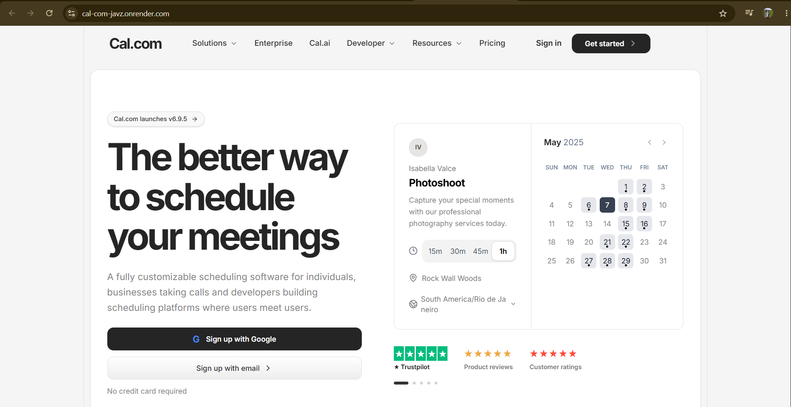

# Cal.com — Scheduling Website UI

A responsive scheduling website recreation inspired by Cal.com, built with React and Tailwind CSS.

A modern interface featuring a polished landing page, pricing plans, enterprise sections, and authentication screens.

<div align="center">
  
</div>

<p align="center">
  <a href="#-features">Features</a> ·
  <a href="#-tech-stack">Tech Stack</a> ·
  <a href="#-getting-started">Getting Started</a> ·
  <a href="#-project-structure">Project Structure</a>
</p>

## ✨ Features

- **Landing page:** Responsive hero section, calls to action, and supporting content.
- **Enterprise sections:** Feature cards, security and compliance content, and use-case sections.
- **Pricing page:** Subscription plan cards and feature comparison.
- **Sticky feature comparison:** Plan headers remain visible while the feature list scrolls.
- **Sign-in page:** Dark UI, Google and Microsoft sign-in buttons, email/password fields, and password visibility toggle.
- **Sign-up flow:** Email sign-up form and booking-calendar preview.
- **Reusable components:** Shared buttons and consistent styling.
- **Responsive design:** Layouts adapt to desktop, tablet, and mobile screens.
- **Visual details:** Dotted world-map backgrounds, grid patterns, borders, shadows, and hover states.

> This is a front-end recreation inspired by Cal.com. Authentication providers and backend flows must be connected to real services before production use.

## 🖼️ Landing Page Preview

The README displays your screenshot from `public/landing-page.png`.

To add it:

1. Run the project locally.
2. Open the landing page in your browser.
3. Take a screenshot of the page.
4. Save it as `landing-page.png` inside the `public` folder.

## 🧰 Tech Stack

- **React** — Component-based UI
- **Vite** — Development server and build tooling
- **Tailwind CSS** — Utility-first styling
- **Lucide React** — Interface icons
- **React Router** — Page navigation, if configured in the project

## 🚀 Getting Started

### Prerequisites

Install Node.js (LTS recommended) and npm.

### Installation

Clone your repository:

```bash
git clone <your-repository-url>
cd <your-project-folder>
```

Install dependencies:

```bash
npm install
```

Start the development server:

```bash
npm run dev
```

Open the local URL printed in your terminal, usually `http://localhost:5173`.

### Production Build

```bash
npm run build
npm run preview
```

## 📁 Project Structure

Your actual folder structure may differ. A typical structure is:

```text
src/
├── components/
│   ├── ui/
│   │   └── Button.jsx
│   └── sections/
├── pages/
│   ├── Signin.jsx
│   └── Signup.jsx
├── styles/
│   └── Signin.css
├── App.jsx
└── main.jsx

public/
├── favicon.svg
└── landing-page.png
```

## 🎨 Design Notes

- Clean white cards on a soft light-gray background
- Dark charcoal primary buttons with subtle hover transitions
- Rounded corners, thin borders, and restrained shadows
- Bold headings with tight letter spacing
- Dark sign-in screen with a dotted world-map visual
- Consistent spacing and typography throughout

## 🔐 Authentication Notes

The authentication UI is only a presentation layer unless you have connected your own services.

Before using it for real accounts:

- Connect form submissions to your authentication API.
- Configure Google and Microsoft OAuth credentials and callback URLs.
- Add validation, loading, and error states.
- Keep secrets in environment variables and never commit them to Git.
- Use HTTPS in production.

## 🛣️ Roadmap

- [ ] Add the final landing-page screenshot to `public/landing-page.png`
- [ ] Verify all routes on mobile and desktop
- [ ] Connect sign-in and sign-up to the backend
- [ ] Connect OAuth providers
- [ ] Add accessible loading and error states
- [ ] Deploy the production build

## 📄 License

This project is intended for learning and portfolio purposes. Cal.com is a separate product, and its name and branding belong to their respective owners. Add a license if you intend to distribute your own code.

---

<div align="center">
  <strong>Built with React, Tailwind CSS, and attention to detail.</strong>
</div>